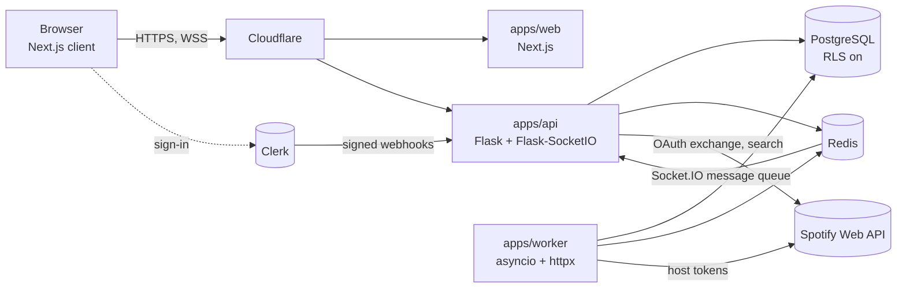

# imbooored

A web app for finding music through strangers' Spotify Jams. A host publishes a room that points to their Jam and tags it (`#postpunk`, `#darkwave`). Listeners browse live rooms, watch the current track update in real time, suggest tracks, and vote. A suggestion that reaches the vote threshold is added to the host's Spotify queue.

The name is always lowercase. It is the boredom of algorithmic playlists, spelled out.

## Status

| Area | State |
|---|---|
| Phase | Planning. There is no application code in this repository yet. |
| Planning docs | Written (docs 00 to 09, OpenAPI draft, steering files). Owner review pending. |
| Spotify spike | Partly run on 2026-11-10. Login, refresh, search and queue-add work as a Jam participant. The host-token test and the non-allowlisted 403 test are still open. See [spike results](docs/00-spotify-spike-results.md). |
| First spec | S01 Foundation. [Requirements](.kiro/specs/01-foundation/requirements.md) are drafted and waiting for approval. |
| Release | None. Nothing is deployed. |

Everything about Spotify behavior in this repo is treated as UNVERIFIED unless the spike results or a cited official page prove it.

## How it works

1. A host connects Spotify once (OAuth, host only), pastes their Jam invite link, adds 1 to 5 hashtags, and opens a room.
2. A background worker polls the host's playback on the server and pushes changes to everyone in the room over Socket.IO. Browsers never talk to Spotify.
3. A listener opens the feed, filters by tag, and swipes between rooms.
4. In a room the listener sees cover, title, artist, and a progress bar that moves locally between server updates.
5. The listener searches for a track through our server and suggests it. Other listeners vote.
6. When votes reach the room threshold, the worker adds the track to the host's Spotify queue with the host's token.
7. The host can reject suggestions and close the room. Rooms also close on their own if the host disappears or playback stays idle.

Listeners never authorize Spotify. Only hosts do.

## Why this is a closed alpha

Spotify's Web API in Development Mode allows at most 5 authorized users per app, added by hand to an allowlist. Extended Quota is open only to registered organizations with at least 250,000 monthly active users. For an individual project that means roughly 5 hosts, including the owner, for as long as these rules stand.

Other limits that shape the design:

- The app owner needs an active Premium subscription, or the app stops working.
- Search returns at most 10 results per request.
- Quota is counted per developer account and shared across Client IDs. A quota 429 (`QUOTA_EXCEEDED`) is different from a rate-limit 429.
- Refresh tokens expire 6 months after authorization.
- Spotify's Developer Policy forbids games, training ML models on Spotify content, analyzing Spotify content for metrics or profiles, and ads or payments in apps that show Spotify content. Metadata and cover art need Spotify attribution and a link back.

Sources and the full endpoint inventory are in [docs/01-SPOTIFY_CONSTRAINTS.md](docs/01-SPOTIFY_CONSTRAINTS.md). All Spotify access goes through a `MusicProvider` interface, with Fake and Replay implementations for tests and demo mode, so the project is not locked to one provider.

## Architecture



Design decisions that matter:

- Postgres is the source of truth for rooms, votes, suggestions, and the points ledger. Redis holds presence, now-playing snapshots, rate-limit counters, and caches. Everything in Redis can be rebuilt.
- Host refresh tokens are stored encrypted (AES-256-GCM with a key id). Access tokens live only in worker memory.
- Mutations (suggest, vote, close) are REST calls. Sockets carry fan-out, presence, and join/leave.
- Votes are counted in Postgres with an idempotent function, so a suggestion crosses the threshold exactly once.
- Single-instance MVP first. The scale-out path is described but not built.

Full detail, sequence diagrams, failure modes, and capacity numbers: [docs/02-ARCHITECTURE.md](docs/02-ARCHITECTURE.md).

## Planned stack

| Layer | Choice |
|---|---|
| Web | Next.js (App Router), TypeScript, Tailwind, Inter |
| API | Flask, Flask-SocketIO (threaded mode, no eventlet) |
| Worker | Python asyncio, httpx |
| Data | PostgreSQL with row-level security, Redis |
| Identity | Clerk (the backend only verifies tokens) |
| Edge | Cloudflare |
| Local and CI | Docker Compose, GitHub Actions |
| Tests | pytest, vitest, Playwright |

Every dependency is a candidate until the owner approves it. The list, registry URLs, and reasons are in [.kiro/steering/tech.md](.kiro/steering/tech.md). Approvals are recorded in [docs/DECISIONS.md](docs/DECISIONS.md).

## Repository layout

Today:

```text
.
├─ .kiro/
│  ├─ steering/     security rules, product, tech, structure, per-app conventions
│  └─ specs/        one folder per feature spec (S01 so far)
├─ docs/            planning docs, OpenAPI draft, progress log
│  └─ reference/    the original design chat and the Kiro playbook
├─ .gitignore
└─ README.md
```

Planned from S01:

```text
apps/web          Next.js UI (no Spotify calls)
apps/api          REST /api/v1, sockets, OAuth exchange, search proxy
apps/worker       polling, token manager, queue push, ghost rooms, reconcile
packages/contracts   types generated from docs/api/openapi.yaml
packages/py-shared   settings, logging, DB roles, close_room, MusicProvider, token vault
infra             docker-compose, Dockerfiles, CI, edge config
```

The rules for the layout live in [.kiro/steering/structure.md](.kiro/steering/structure.md).

## Documentation

| Doc | What it covers |
|---|---|
| [00 Project brief](docs/00-PROJECT_BRIEF.md) | Problem, personas, core loop, scope, metrics, glossary |
| [00 Spike results](docs/00-spotify-spike-results.md) | What was actually tested against Spotify, with dates and evidence names |
| [01 Spotify constraints](docs/01-SPOTIFY_CONSTRAINTS.md) | Access model, endpoint inventory, MusicProvider contract, rollout stages, kill criteria |
| [02 Architecture](docs/02-ARCHITECTURE.md) | Components, sequence diagrams, degradation, capacity |
| [03 Data model](docs/03-DATA_MODEL.md) | Tables, RLS plan, Redis key map, invariants |
| [04 API and events](docs/04-API_AND_EVENTS.md) | REST and Socket.IO contract, error envelope, limits |
| [api/openapi.yaml](docs/api/openapi.yaml) | Machine-readable REST contract (draft) |
| [05 Threat model](docs/05-SECURITY_THREAT_MODEL.md) | STRIDE, abuse cases, mapping of all 24 security rules |
| [06 UX spec](docs/06-UX_SPEC.md) | Screens, states, swipe and keyboard navigation, tokens, copy |
| [07 Roadmap](docs/07-ROADMAP.md) | Milestones M0 to M5, specs S01 to S10 |
| [08 Test strategy](docs/08-TEST_STRATEGY.md) | Test pyramid, abuse-case catalog, load plan, CI gates |
| [09 Ops runbook](docs/09-OPS_RUNBOOK.md) | Environments, secret rotation, backups, alerts, incident playbooks |
| [Decisions](docs/DECISIONS.md) | ADR log and open questions for the owner |
| [Progress](docs/PROGRESS.md) | Where work stopped and how to resume |

## Security

The rules are in [.kiro/steering/security.md](.kiro/steering/security.md) and apply to every spec and task. They are treated as non-negotiable. The ones that shape most decisions:

- Authentication is Clerk. The backend verifies tokens with a maintained library and never builds its own sessions.
- Spotify OAuth is an integration, always with `state` and PKCE.
- Secrets come from the environment or a secret manager, are rotated at least every 90 days, and never appear in logs.
- Every endpoint and socket event has authentication, server-side authorization, and a Redis-backed rate limit. Exceptions are listed in the ADR log.
- Row-level security is on for every table from the first migration. The API connects with a least-privilege role.
- SQL uses bound parameters only. User text is rendered escaped. Tags are normalized to `[a-z0-9_]{2,30}`.
- The Jam link is validated by an allow-list pattern, stored as data, and never fetched.
- CORS and Socket.IO origins are explicit lists. Never `*`.
- Dependencies are added only with owner approval and checked by real tooling (Dependabot, `pip-audit`, `npm audit`, OSV-Scanner), not by a model's opinion.
- Account deletion and data export are planned before the first outside invite (Indonesia's UU PDP, GDPR, CCPA).

How each rule maps to a control, a spec, and a test is in [docs/05-SECURITY_THREAT_MODEL.md](docs/05-SECURITY_THREAT_MODEL.md). Rules that cannot be fully met yet (separate Spotify Client IDs per environment, Spotify token revocation, hosting-dependent items) are listed there with the reason.

Found a vulnerability? There is no public deployment yet. Open a private report with the repository owner instead of a public issue.

## Spotify spike

The spike tests the riskiest assumptions before any feature code is written. Status as of 2026-11-10:

| Check | Result |
|---|---|
| OAuth with PKCE and three scopes | Pass |
| Refresh grant does not return a new refresh token | Pass |
| `currently-playing` returns the Jam track | Partial. Tested with a participant token, not with the host's token. |
| Queue add lands in the Jam | Partial. Worked with a participant token, host token untested. |
| Client-credentials search, `limit=10` | Pass. Other limit cases need a re-run. |
| Non-allowlisted account gets 403 | Not tested. |
| Rate-limit headers | None seen on normal responses. |

If the host-token test fails, the product concept has to change before any Spotify-facing spec starts. The kill criteria are in [docs/01-SPOTIFY_CONSTRAINTS.md](docs/01-SPOTIFY_CONSTRAINTS.md#7-kill-criteria).

The spike script lives outside this repository on purpose, because it handles credentials. Evidence files are scrubbed of tokens, emails, and device ids, and are reviewed before any of them is reused as a test fixture.

## Roadmap

| Milestone | Contents | Exit criteria in short |
|---|---|---|
| M0 | Planning baseline and spike | Spike items 3 and 4 pass with a host token, owner answers the blocking questions |
| M1 | S01 Foundation, S02 Identity | CI gates green, sign-in works on staging, RLS tests pass |
| M2 | S03 Spotify connect, S04 Rooms, S05 Realtime | A second browser sees track changes from the owner's room |
| M3 | S06 Feed, S07 Suggest and vote, S09 Resilience, S10a Privacy | Full loop works with 2 hosts on staging, restore drill executed |
| M4 | S08 UX polish | Keyboard and screen-reader pass, 4 weeks of alpha data |
| M5 | S10b Ops | First secret rotation rehearsed, continue or stop decision recorded |

Specs, dependencies, sizes, and risks: [docs/07-ROADMAP.md](docs/07-ROADMAP.md).

## How work is done here

The project is built with Kiro using specs. Each feature goes through three approved documents in order: `requirements.md`, `design.md`, `tasks.md`. Nothing moves on until the previous one is approved.

- Docs are the source of truth. If a decision changes, the doc changes in the same commit.
- One spec is one vertical slice that can be demoed. One task runs per chat session.
- The first task of every spec is a failing test or contract test.
- Features that touch auth, tokens, or user data use the full spec flow, not a quick spec.
- Before merge: read the full diff, run the tests yourself, run the security review from the playbook, and let CI pass.

The step-by-step playbook, including the prompts used for planning, spec writing, and review, is in [docs/reference/imbooored_Kiro_Playbook.md](docs/reference/imbooored_Kiro_Playbook.md). The design chat the project started from is in [docs/reference/](docs/reference/). It is kept as draft ideas, not as truth.

## Getting started

There is nothing to run yet. To follow the project:

1. Read [docs/00-PROJECT_BRIEF.md](docs/00-PROJECT_BRIEF.md), then [docs/01-SPOTIFY_CONSTRAINTS.md](docs/01-SPOTIFY_CONSTRAINTS.md).
2. Check [docs/PROGRESS.md](docs/PROGRESS.md) for the current step and open decisions.
3. Review [S01 requirements](.kiro/specs/01-foundation/requirements.md).

Local development starts with S01, which will add a one-command Docker Compose setup. Exact tool versions (Node, Python, package managers) are chosen in S01's design from current official release notes and will be documented here when they exist. Never commit a `.env` file, and never paste real secrets into issues, chats, or logs.

## Contributing

This is a solo project at the moment. If that changes, the ground rules already apply:

- Follow the steering files in `.kiro/steering/`.
- Do not add a dependency without the approval trail in the ADR log.
- Do not expand a task's scope or refactor unrelated code.
- Update the matching doc in the same change as the code.

## Third-party notices

imbooored is not affiliated with, endorsed by, or sponsored by Spotify. Spotify is a trademark of Spotify AB. Track metadata and cover art shown in the app come from Spotify's Web API and are displayed with attribution and a link back to Spotify, as the Developer Policy requires. The app does not play audio.

## License

No license has been chosen yet. Until one is added, all rights are reserved.
