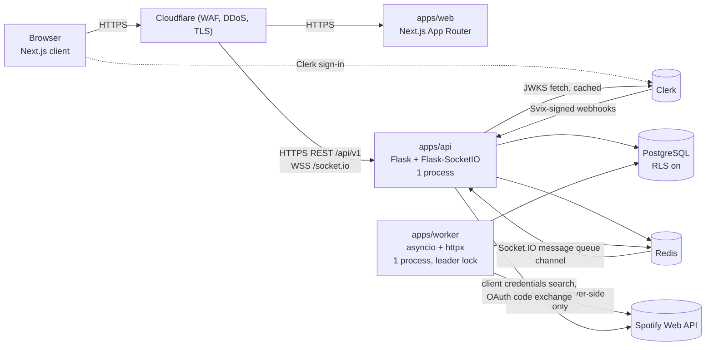
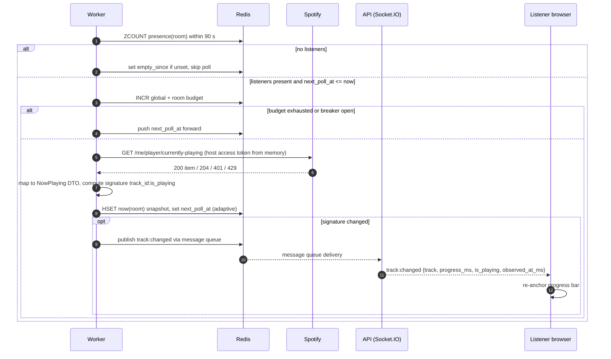
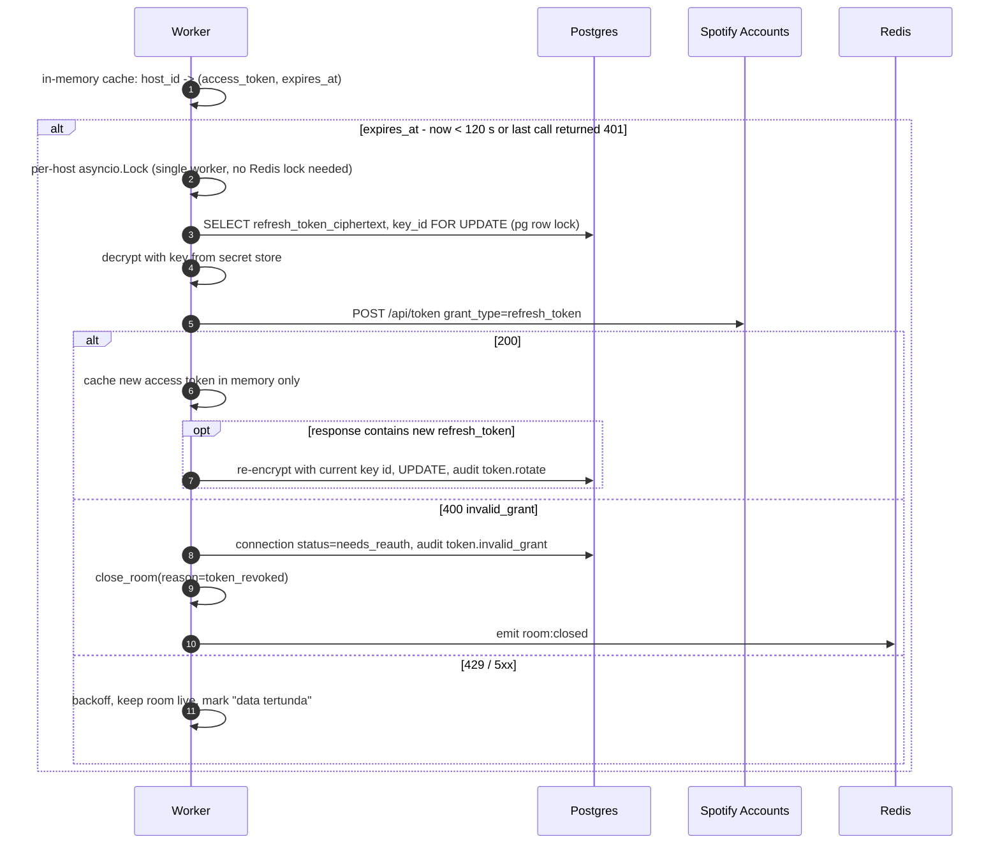

# 02 · Architecture

Status: DRAFT · Written 2026-11-09

## Purpose

Show the components, who talks to whom, the four critical flows, how the system degrades, and the numbers behind sizing. Single-instance MVP first. Scale-out is described, not built.

## Content

### 1. Components



| Component | Responsibility | Never does |
|---|---|---|
| `apps/web` | UI, Clerk session in the browser, calls API with a Clerk session token, Socket.IO client, progress interpolation | Talk to Spotify, hold Spotify tokens, render unescaped user text |
| `apps/api` | REST `/api/v1`, Socket.IO server (auth on connect, join authz, presence), OAuth code exchange, search proxy, vote/threshold transaction, Clerk webhooks | Poll Spotify, call Player endpoints, keep access tokens in Redis |
| `apps/worker` | Poll currently-playing, refresh host tokens (in memory), push approved tracks, close ghost rooms, reconcile Redis with DB on start | Serve HTTP (except an internal health port), accept browser traffic |
| Redis | Presence, now-playing snapshot, poll schedule, rate-limit counters, search cache, push stream, Socket.IO message queue | Be the only copy of any fact that matters (rooms, votes, tokens live in Postgres) |
| PostgreSQL | Source of truth: users, connections (encrypted), rooms, tags, suggestions, votes, ledger, audit | Store plaintext tokens |

Process model (ADR-003, ADR-004):

- API runs `gunicorn -w 1 --threads <N>` with the threaded worker and `simple-websocket`, as the Flask-SocketIO deployment docs describe. No eventlet: the eventlet project discourages new usage. Gunicorn cannot run more than one Socket.IO worker per instance.
- Worker runs one asyncio process. A Redis leader lock (`imb:lock:worker_leader`, TTL 15 s, renewed every 5 s) prevents two workers polling at once during deploys.
- Worker emits Socket.IO events through the Redis message queue as an external process, using `socketio.AsyncRedisManager(..., write_only=True)` on the same channel as the API.

### 2. Flow: track change



Adaptive interval, per room, only while listeners are present:

| Situation | Next poll in |
|---|---|
| Playing, > 30 s left | 10 s |
| Playing, 15–30 s left | 5 s |
| Playing, < 15 s left | 2.5 s |
| Paused | 10 s |
| 204 / ad / local file | 15 s |
| 5xx / network | 5 s × 2^n, cap 60 s |
| 429 rate-limit | `Retry-After` for **all** rooms (global breaker) |
| 429 `QUOTA_EXCEEDED` | breaker open 15 min, alert owner, rooms show "Data lagu tertunda" |

### 3. Flow: suggest → vote → queue

```mermaid
sequenceDiagram
  autonumber
  participant L as Listener
  participant A as API
  participant P as Postgres
  participant R as Redis
  participant W as Worker
  participant S as Spotify
  L->>A: POST /rooms/{id}/suggestions {track_id}
  A->>A: authn, rate limit, room live?, member in room?
  A->>R: search cache lookup by track_id
  alt cache miss
    A->>S: GET /tracks/{id} (client credentials)
  end
  A->>P: INSERT queue_items (pending) ON CONFLICT active duplicate -> return existing
  A-->>L: 201 suggestion
  A->>R: emit suggestion:created
  L->>A: PUT /rooms/{id}/suggestions/{sid}/vote
  A->>P: BEGIN; INSERT votes ON CONFLICT DO NOTHING; UPDATE queue_items SET vote_count+1, status=approved WHERE pending AND vote_count+1 >= threshold RETURNING; COMMIT
  A->>R: emit vote:updated
  opt status became approved (exactly once)
    A->>R: XADD imb:stream:queue_push {queue_item_id}
    W->>R: XREADGROUP
    W->>P: UPDATE status=pushing WHERE approved (claim)
    W->>S: POST /me/player/queue?uri=spotify:track:{id}
    alt 2xx
      W->>P: status=queued, ledger rows
      W->>R: emit suggestion:status queued
    else no device / premium / 429 / 5xx
      W->>P: status=approved, push_attempts+1, last_error_code
      W->>R: retry per policy or status=failed after 3 attempts / 10 min
    end
  end
```

Idempotency: `votes` primary key `(queue_item_id, user_id)`; the threshold `UPDATE ... WHERE status='pending'` returns a row at most once; the worker claims with `WHERE status='approved'` before calling Spotify. A push that succeeded at Spotify but failed to commit locally can duplicate a queue entry on retry. Spotify has no idempotency key for queue add (UNVERIFIED), so we accept a rare duplicate and record it in the audit log.

### 4. Flow: room create and close

```mermaid
sequenceDiagram
  autonumber
  participant H as Host browser
  participant A as API
  participant P as Postgres
  participant R as Redis
  participant W as Worker
  H->>A: POST /rooms {jam_link, tags[], vote_threshold} + Idempotency-Key
  A->>A: authn, role=host, spotify connection active, regex on jam_link, normalize tags
  A->>P: INSERT rooms (live): partial unique index rejects 2nd live room -> 409
  A->>P: INSERT audit_log room.create
  A->>R: SADD imb:rooms:live, init poll hash
  alt Redis write fails
    A-->>H: 201 anyway; worker reconcile adds it within 30 s
  end
  A-->>H: 201 room
  Note over H,W: ...later...
  H->>A: POST /rooms/{id}/close
  A->>A: authz: owner host or admin
  A->>R: SET imb:lock:room_close:{id} NX EX 15
  A->>P: UPDATE rooms SET status=closed WHERE id AND status=live RETURNING; cancel pending/approved suggestions; audit
  A->>R: SREM live set, DEL room keys (fixed key list), emit room:closed, close Socket.IO room
  A-->>H: 200 {status: closed} (also 200 if already closed)
```

Order: DB first, then Redis. If Redis cleanup fails, the room is still closed in the DB and the worker reconcile loop (every 30 s) removes stale Redis state. The same `close_room(room_id, reason, actor)` function lives in a shared package and is used by the API, the worker (ghost rooms, `invalid_grant`), and admin force-close.

### 5. Flow: token refresh



Access tokens never leave worker memory. On worker restart every host with a live room is refreshed once (5 calls at most).

### 6. Failure and degradation

| Failure | Detection | Behavior | Recovery |
|---|---|---|---|
| Spotify 429 rate limit | status 429 without `QUOTA_EXCEEDED` | Global breaker for `Retry-After` seconds; snapshots stay, UI shows last known track with "tertunda" badge after 30 s | Automatic |
| Spotify `QUOTA_EXCEEDED` | 429 body reason | Breaker 15 min, search returns 503 `SPOTIFY_QUOTA`, pushes wait, alert owner | Automatic retry; owner reviews budget |
| Spotify 5xx / timeout | status, httpx timeout 5 s | Per-room exponential backoff; after 5 min of failures show "Spotify sedang bermasalah" | Automatic |
| Host token `invalid_grant` | refresh 400 | Close room `token_revoked`, connection `needs_reauth`, host sees reconnect banner | Host reconnects |
| Host has no active device at push | provider error | Suggestion stays `approved`, retry at 1, 3, 6 min, then `failed`; host sees "Buka Spotify untuk menerima antrean" | Host opens Spotify |
| Redis down | connection errors | API: REST mutations still write Postgres; realtime stops; feed served from Postgres without now-playing; rate limiter **fails closed** for mutations, open for `GET /feed` with Cloudflare limit | Restart Redis; worker reconcile rebuilds live set and snapshots |
| Postgres down | connection errors | API returns 503 on all except `/healthz`; worker pauses pushes, keeps polling snapshots for live rooms already in memory for at most 10 min | Restore per [09](./09-OPS_RUNBOOK.md) |
| Worker down | leader lock not renewed, no snapshot updates > 60 s | UI shows stale badge; votes still collected; approved suggestions wait | Platform restart; on start: reconcile, refresh tokens, drain stream |
| API restart | Socket disconnects | Clients reconnect with jittered backoff and re-join; presence ZSet entries expire after 90 s so ghost sids disappear | Automatic |
| Clerk JWKS unreachable | fetch error | Use cached JWKS (until key rotation); fail closed when no cached key matches `kid` | Automatic |

### 7. Capacity assumptions

Polling estimate per room with listeners, 3.5-minute track: 18 polls at 10 s + 3 at 5 s + 6 at 2.5 s = 27 polls per 210 s ≈ **7.7 polls/min**.

| Quantity | 5 hosts (alpha) | 300 rooms (hypothetical) |
|---|---|---|
| Live rooms at peak | 5 | 300 |
| Concurrent listener sockets | 50 (cap 100 accounts) | 6,000 (20 per room) |
| Spotify polls | 39/min (0.65 rps) | 2,310/min (38.5 rps) |
| Queue pushes | ~2/min | ~100/min |
| Search calls to Spotify (after 10 min cache, ~40% hit) | ~3/min | ~150/min |
| Token refreshes | 5/hour | 300/hour |
| Total Spotify calls | **~45/min** | **~2,600/min** |
| Socket fan-out messages | ~10/min | ~1,700/min (300 rooms × 1 change / 3.5 min × 20) |
| Postgres writes | < 1/s | ~20/s peak (votes) |
| Redis ops | < 50/s | ~3,000/s |

Default global Spotify budget: **120 calls/min**, of which polling may use 70%. Spotify publishes no number (C8 in [01](./01-SPOTIFY_CONSTRAINTS.md)), so this is a guess to tune from spike and alpha data.

The 300-room column cannot happen in Dev Mode (5-user allowlist). It exists to show where the design breaks: Spotify access first, then the socket model (threaded Socket.IO holds one thread per WebSocket, so 6,000 sockets do not fit in one process).

### 8. Scale-out path (not built)

1. Raise `--threads` and measure (S09 load test).
2. Run several single-worker API instances behind a load balancer with sticky sessions and the Redis message queue (Flask-SocketIO "Using Multiple Workers").
3. If thread-per-socket is the limit, move realtime to an async Socket.IO server (python-socketio ASGI) behind the same events contract. Requires an ADR.
4. Shard worker polling by `hash(room_id) % n` with per-shard leader locks.
5. Read replica for feed queries.

None of this is worth doing while Spotify caps us at 5 hosts.

## Assumptions

- Hosting platform not chosen (OQ-5). Diagrams assume containers for api/worker, Postgres and Redis as managed services, Next.js on a platform that supports App Router.
- Cloudflare proxies WebSockets for our plan tier (UNVERIFIED, check plan limits).
- Thread count needed for 50–100 sockets fits a small instance (UNVERIFIED until S09 load test).

## Open questions

- Should the API also call Spotify for search, or should all Spotify calls go through the worker? Current choice: API does search and code exchange (needs client secret in two services). Moving search to the worker adds a request/reply hop. (ADR-004)
- Accept rare duplicate queue entries on retry? (ADR-008)

## Verified sources

| Fact | Source | Accessed |
|---|---|---|
| Gunicorn: one worker only; threaded worker + simple-websocket option; multiple workers need sticky sessions + message queue; external process emit; same-origin default, `cors_allowed_origins` | https://flask-socketio.readthedocs.io/en/latest/deployment.html | 2026-11-09 |
| Eventlet discourages new projects | https://eventlet.readthedocs.io/en/latest/asyncio/migration.html, https://pypi.org/project/eventlet/ | 2026-11-09 |
| `AsyncRedisManager(write_only=True)` for external emitters | https://python-socketio.readthedocs.io/en/latest/api.html (index read only; parameter behavior UNVERIFIED) | 2026-11-09 |
| Spotify rate limit rolling 30 s window | https://developer.spotify.com/documentation/web-api/guides/rate-limits/ | 2026-11-09 |
| Spotify runtime behavior | UNVERIFIED (spike not run) | n/a |
