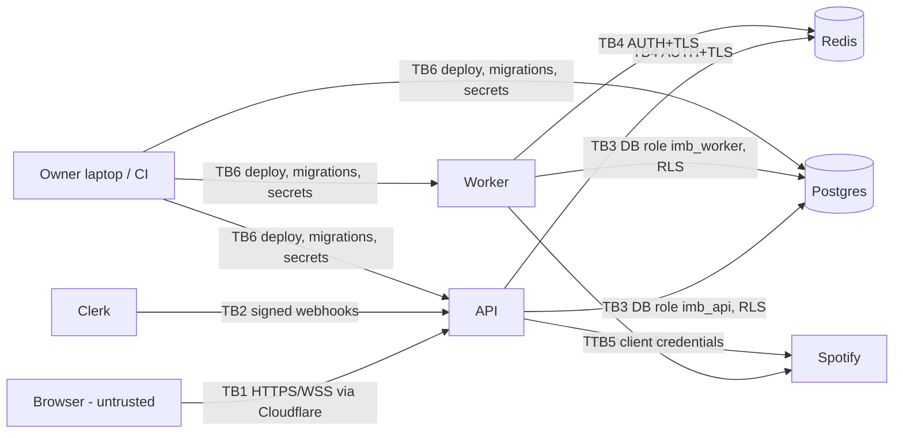

# 05 · Security Threat Model

Status: DRAFT · Written 2026-11-09 · Rules source: `.kiro/steering/security.md` (text taken from playbook §4 because the file is not in the repo yet; see [DECISIONS.md](./DECISIONS.md) OQ-0)

## Purpose

Name what we protect, where trust changes, how it can be attacked, and which control, spec, and test covers each of the 24 security rules. A rule with no control is a blocker for the spec that touches it.

## Content

### 1. Assets

| Asset | Why it matters | Where it lives |
|---|---|---|
| Host Spotify refresh tokens | Full control of host's playback for 6 months | Postgres ciphertext; data key in secret store |
| Host Spotify access tokens | 1 h control of playback | Worker memory only |
| Spotify client secret | Impersonate our app, burn the shared quota | Secret store → api, worker env |
| Clerk secret key, webhook signing secret | Forge users or events | Secret store → api |
| Token-vault data keys | Decrypt every refresh token | Secret store, referenced by `key_id` |
| Spotify quota (per developer account) | Exhaustion takes down every room | Spotify |
| User data (display name, Clerk id, votes, suggestions, ledger) | UU PDP / GDPR personal data | Postgres |
| Host's Spotify queue | Abuse lands in a real person's listening session | Spotify |
| Audit log | Evidence for incidents | Postgres |

### 2. Trust boundaries



TB1 is the main attack surface. TB5 responses are also untrusted input (track titles are user-controlled on Spotify's side: local file names, podcast titles).

### 3. STRIDE

| Threat | Example | Control | Spec |
|---|---|---|---|
| Spoofing | Forged/expired Clerk token; token from another Clerk instance; token minted for another site (`azp`) | JWKS verify with maintained lib, check `iss`, `exp`, `nbf`, `azp` allow-list | S02 |
| Spoofing | Fake Clerk webhook creates admin | Svix signature verified before parse; timestamp ≤ 5 min; role never set from webhook payload | S02 |
| Spoofing | OAuth CSRF / code injection on Spotify callback | 256-bit `state` bound to user, single-use, 10 min; PKCE S256; exact `redirect_uri` allow-list | S03 |
| Tampering | Client sends another room's `room_id` or a fake track title | Server re-derives membership; metadata fetched server-side; Pydantic/JSON Schema strict | S05, S07 |
| Tampering | SQL injection via tag filter | Bound params, exact match on normalized slug | S04, S06 |
| Repudiation | Host denies closing room / admin role change disputed | Append-only `audit_log` with actor, request id | S04, S10 |
| Info disclosure | Token in logs or error bodies | Structured logger with redaction, no raw upstream bodies, CI grep gate | S01 |
| Info disclosure | Raw Spotify payload leaks extra fields | Whitelisted DTO mapping in `MusicProvider` | S03, S07 |
| Info disclosure | IDOR on exports | Owner-only, 404 for others, signed URL 24 h | S10 |
| DoS | Feed scraping, search spam burns quota | Per-user and per-IP limits, search gate, cache, global Spotify budget + breaker | S05–S07 |
| DoS | Socket flood / giant payloads | 4 KB inbound cap, per-event limits, connect limits, Cloudflare | S05 |
| Elevation | Listener calls host-only endpoints | Server-side role + ownership checks, RLS as second layer | S02, S04 |
| Elevation | API compromised → read all tokens | API role cannot SELECT ciphertext columns; only worker decrypts | S03 |

### 4. Abuse cases

| Abuse | Attack | Controls | Test (see [08](./08-TEST_STRATEGY.md)) |
|---|---|---|---|
| Vote brigading | Many accounts push a troll track into a stranger's Jam | Votes require room membership (presence), account age ≥ 10 min, per-user vote limits, suggestion caps, threshold set by host, host reject, admin can disable accounts in Clerk, invite-only alpha | `test_vote_requires_presence`, `test_vote_rate_limit`, `test_new_account_cannot_suggest` |
| Room spam | Host opens/closes rooms to flood feed | One live room per host (I1), 5 creates/hour, max 5 hosts | `test_second_live_room_409`, `test_room_create_rate_limit` |
| Token theft | DB dump, log leak, XSS reading tokens | Ciphertext only, key in secret store, access tokens never in DB/Redis/browser, CSP | `test_logs_redact_tokens`, `test_no_token_in_any_response` |
| SSRF via Jam link | `jam_link=http://169.254.169.254/` | Strict regex, stored only, never fetched, no link previews | `test_jam_link_rejects_*`, grep gate: no HTTP client call takes a user value |
| Stored XSS via tags | `#<script>` | Slug regex rejects; React escaping; no `dangerouslySetInnerHTML` (lint rule) | `test_tag_normalization`, Playwright XSS payload test |
| Stored XSS via track titles | Malicious local-file title from Spotify | Treated as untrusted text, length-capped, rendered escaped | `test_track_title_rendered_escaped` |
| CSWSH | Evil site opens WebSocket with victim's cookies | Token in `auth` payload (not cookies), `Origin` allow-list check at handshake | `test_socket_rejects_foreign_origin`, `test_socket_rejects_missing_token` |
| Quota-exhaustion DoS | Bot searches unique strings | Search gate (member of a live room), 20/min + 200/day per user, 10 min cache, global budget, breaker | `test_search_budget_enforced`, load test |
| Enumeration | Guess room/user ids, export ids | UUID v4, 404 for non-owned, rate limits | `test_export_idor_404` |
| Webhook replay | Resend old Clerk `user.deleted` | Timestamp window + `webhook_events` idempotency | `test_webhook_replay_ignored` |
| Open redirect | `next=https://evil` after sign-in or connect | Allow-list of relative paths only | `test_redirect_allowlist` |
| Host impersonation in socket | Listener claims host presence | `is_host` derived server-side from DB `rooms.host_id` | `test_host_presence_server_derived` |

Jam link allow-list (draft; final pattern from spike fixtures, UNVERIFIED):

```text
^https://(spotify\.link/[A-Za-z0-9]{6,20}|open\.spotify\.com/socialsession/[A-Za-z0-9]{10,40})$
```

Query strings are stripped before matching. Anything else returns `INVALID_JAM_LINK`.

### 5. Rule mapping (security.md 1–24)

Status values: `planned` (designed, not built), `gap` (cannot be fully met, see note), `open` (needs owner decision).

| # | Rule (short) | Concrete control | Spec | Test | Status |
|---|---|---|---|---|---|
| 1 | Session ≤ 7 days, rotation | Clerk max lifetime 7 days (default on new instances); short-lived session tokens. Whether Clerk's model counts as "refresh-token rotation" is UNVERIFIED | S02 | config check in release checklist; `test_expired_token_401` | gap (wording) |
| 2 | No hand-built auth | Clerk; backend verifies JWKS with maintained lib; Spotify OAuth uses state + PKCE | S02, S03 | forged/expired/wrong-`azp`/wrong-`iss` token tests; state replay test | planned |
| 3 | Secrets via env/secret manager | Platform secret store (MVP) → secret manager (target); `.env` only for local dev; pydantic-settings fail-fast | S01 | gitleaks in CI; startup fails without required secrets | planned (manager choice open, OQ-5) |
| 4 | Rotate secrets ≤ 90 days | Rotation table in [09](./09-OPS_RUNBOOK.md); vault `key_id` supports re-encryption | S10 | rotation rehearsal recorded | planned |
| 5 | Dependency approval, no "secure" claims | Every dep listed in tech.md with registry URL, tagged NEEDS HUMAN VERIFICATION; owner approves | all | PR checklist; hook rejects manifest change without DECISIONS entry | planned |
| 6 | Patched versions, lockfiles, exact pins | `pnpm-lock.yaml`, `uv.lock`; exact versions | S01 | CI fails on unpinned ranges | planned |
| 7 | Audit in CI fails on high/critical; no auto-fix | `pip-audit`, `pnpm audit --audit-level=high`, OSV-Scanner; Dependabot PRs only | S01 | CI job | planned |
| 8 | Parameterized queries; no LIKE on user input | SQLAlchemy Core bound params; exact slug match | S04, S06 | grep gate for f-string SQL; `test_tag_filter_exact` | planned |
| 9 | RLS deny-by-default from first migration; least-privilege role | ENABLE + FORCE RLS; roles in [03](./03-DATA_MODEL.md) §3 | S01 (baseline), S02 | `test_rls_denies_without_app_user`, `test_api_role_not_owner` | planned |
| 10 | No console.log/print; redacting logger | structlog JSON + redaction processor; ESLint `no-console`; CI grep for `print(` / `console.` | S01 | CI gate; `test_logs_redact_tokens` | planned |
| 11 | CORS / Socket.IO origins allow-list; WS Origin check | one env list `ALLOWED_ORIGINS` feeds REST CORS headers and Flask-SocketIO `cors_allowed_origins`; connect handler re-checks `Origin` | S01, S05 | `test_cors_rejects_foreign_origin`, `test_socket_rejects_foreign_origin` | planned |
| 12 | Redirect allow-list; no SSRF | Exact `redirect_uri` per env; relative-path `next`; Jam link never fetched | S03, S04 | redirect tests; SSRF grep gate | planned |
| 13 | Authn + authz + rate limit on every endpoint/event | Decorators required by a route-registry test that fails if a route lacks them; `/healthz` exception (ADR-013) | S01, all | `test_every_route_has_auth_and_limit` | planned |
| 14 | Cost controls | Spotify global + per-room budget, breaker, QUOTA alert; provider spend alerts | S05, S09 | budget tests; alert drill | planned |
| 15 | WAF/DDoS edge; origin only from edge | Cloudflare proxy; origin lock depends on host (allow-list Cloudflare IPs or tunnel) | S01, S10 | external port scan in release checklist | open (OQ-5) |
| 16 | No uploads in MVP | No upload endpoints; route-registry test rejects multipart | n/a | `test_no_multipart_routes` | planned |
| 17 | Upload validation | Not applicable (no uploads) | n/a | n/a | n/a |
| 18 | Verify webhook signatures first; idempotent; reject stale | Svix verification on raw body; `webhook_events`; 5-min window | S02 | bad-signature, replay, stale tests | planned |
| 19 | Server-side authz for every action | Role + ownership + membership checks in service layer; RLS second layer | S02, S04, S05, S07 | authz test catalog in [08](./08-TEST_STRATEGY.md) | planned |
| 20 | Audit critical actions + alert rules | `audit_log` actions list; alert rules in [09](./09-OPS_RUNBOOK.md) | S03, S04, S10 | alert drill | planned (notification channel open, OQ-6) |
| 21 | Deletion + export flows | Deletion job: anonymize, delete votes, delete vault row, purge Redis, delete Clerk user; export JSON. Spotify revoke: **no public revoke API found**, so we delete our copy and instruct the user | S10 | `test_deletion_end_to_end`, `test_export_contents` | gap (Spotify revoke) |
| 22 | Backups + rehearsed restore; Redis not truth | Managed Postgres PITR + nightly logical dump; quarterly drill; Redis rebuildable | S10 | drill log | planned |
| 23 | Strict env separation incl. Spotify Client IDs | Separate DB, Redis, Clerk instances, secrets, domains. Separate Spotify Client IDs **conflict** with Developer Policy "one Security Code per SDA" and the shared per-account quota | S01, S10 | env config check | open (OQ-2, ADR-010) |
| 24 | Non-prod webhooks never reach prod; distinct secrets | Separate Clerk instances → separate endpoints and signing secrets | S02, S10 | config check | planned |

Project-specific hardening:

| Control | Where | Spec |
|---|---|---|
| Refresh tokens AES-256-GCM with `key_id`, AAD = user_id‖key_id; access tokens memory-only | worker, api vault module | S03 |
| Host token used only for that host's room, only server-side | worker | S03, S05 |
| Search returns whitelisted DTO only | api | S07 |
| User text escaped; tags `[a-z0-9_]{2,30}` | api, web | S04, S08 |
| WS: auth on connect, authz on join/emit, schemas, size cap, per-event limits, Origin check | api | S05 |
| Jam link regex, never fetched | api | S04 |
| One live room per host via partial unique index | db | S04 |
| CSP: `default-src 'self'`; `img-src` Spotify image CDN hosts; `connect-src` API + Clerk; no inline scripts except Next.js nonce | web | S01, S08 |

## Assumptions

- Clerk is trusted for identity; if Clerk is compromised, attackers can act as any user but still cannot decrypt Spotify tokens (worker-only).
- Cloudflare is trusted to terminate TLS.
- The owner's laptop and CI are the highest-privilege surfaces; MCP servers never get production credentials (playbook §8).

## Open questions

- OQ-2 Spotify Client IDs per environment (rule 23 vs Developer Policy).
- OQ-5 Hosting platform (rule 15 origin lock, rule 3 secret manager).
- OQ-6 Alert channel (rule 20).

## Verified sources

| Fact | Source | Accessed |
|---|---|---|
| "Use a separate Security Code for each SDA; may not use more than one Security Code for each SDA" | https://developer.spotify.com/policy §VII | 2026-11-09 |
| Disconnect + delete obligations | https://developer.spotify.com/policy §I | 2026-11-09 |
| No Spotify revoke endpoint (community request still open) | https://github.com/spotify/web-api/issues/600 (UNVERIFIED) | 2026-11-09 |
| Clerk max lifetime default 7 days; custom value needs paid plan in production | https://clerk.com/docs/guides/secure/session-options.md | 2026-11-09 |
| Flask-SocketIO origin enforcement | https://flask-socketio.readthedocs.io/en/latest/deployment.html | 2026-11-09 |
| Postgres RLS semantics | https://www.postgresql.org/docs/current/ddl-rowsecurity.html | 2026-11-09 |
| Jam link URL formats | UNVERIFIED | n/a |
