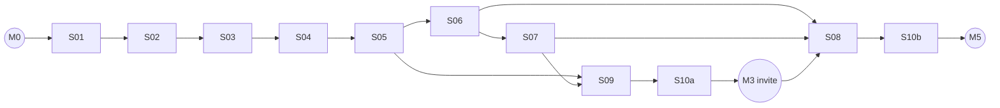

# 07 · Roadmap

Status: DRAFT · Written 2026-11-09

## Purpose

Milestones with exit criteria, and the spec list (S01–S10) with dependencies, size, risk, and the security rules each touches. The seed list from the playbook is the starting point; changes to it are listed in §3 with reasons.

## Content

### 1. Milestones

| Milestone | Contains | Exit criteria (all required) |
|---|---|---|
| **M0 Planning baseline + spike** | Spike, these docs, owner answers | `docs/00-spotify-spike-results.md` exists with dated evidence; kill criteria K1 and K2 pass; `.kiro/steering/security.md` committed; OQ-1 to OQ-5 in [DECISIONS.md](./DECISIONS.md) answered; owner commits `docs: planning baseline` |
| **M1 Foundation + identity** | S01, S02 | CI gates green on `main` (lint, types, tests, pip-audit, pnpm audit, gitleaks, no-console); staging sign-in works; RLS baseline tests pass; route-registry test (every route has authn/authz/limit) passes |
| **M2 Walking skeleton** | S03, S04, S05 | Owner connects Spotify in staging, opens a room, a second browser sees track changes; natural-end latency p95 ≤ 4 s over 20 tracks; demo mode works with `FakeMusicProvider`; token never in logs (sampled) |
| **M3 Closed alpha ready** | S06, S07, S09, S10a | Full loop (feed → room → suggest → vote → queued) with 2 hosts on staging; abuse test catalog green; ghost rooms close by themselves; restore drill **executed** and logged; privacy policy and deletion/export live; Prompt C3 gate + SCA pass; prod deployed; first invites sent |
| **M4 Alpha feedback + polish** | S08, fixes | Keyboard and screen-reader pass on all screens; Lighthouse budget met; 4 weeks of alpha metrics collected ([00](./00-PROJECT_BRIEF.md)) |
| **M5 Operate and decide** | S10b | First 90-day secret rotation rehearsed; alert drill done; continue/kill decision against K4/K5 recorded as an ADR |

### 2. Spec list

Size: S ≈ 1–2 days, M ≈ 3–5 days, L ≈ 1–2 weeks (solo, part-time unknown, so treat as relative).

| ID | Spec | Depends on | Size | Risk | Security rules | Main deliverable |
|---|---|---|---|---|---|---|
| S01 | Foundation | M0 | M | Med (many tools, dependency approvals) | 3, 4, 5, 6, 7, 9 (baseline), 10, 11, 13, 15, 16, 23 | Monorepo skeleton, Docker Compose (api, worker, web, redis, postgres), settings with fail-fast validation, structlog + redaction, CORS allow-list, security headers + CSP baseline, rate-limit module, `/healthz`, Alembic with roles + RLS baseline migration, CI gates, Dependabot, route-registry test |
| S02 | Identity | S01 | M | High (auth) | 1, 2, 9, 18, 19, 24 | Clerk in Next.js, JWKS verification in Flask, Clerk webhook (Svix, idempotent, stale reject), `users` + roles, 18+ confirmation, admin role grant (host cap 5), Socket.IO connect auth |
| S03 | Spotify connect (host) | S02 | L | High (tokens, unverified Spotify) | 3, 4, 12, 14, 19, 20, 21 (disconnect) | `MusicProvider` + `FakeMusicProvider` + `ReplayMusicProvider` (first task), PKCE + state, redirect allow-list, token vault AES-GCM with key id, worker token manager (memory-only access tokens), refresh + rotation + `invalid_grant`, 403 not-allowlisted state, disconnect |
| S04 | Room lifecycle | S03 | M | Med | 8, 12, 13, 19, 20 | Create/close, jam-link regex, tag normalization, partial unique index, idempotency key, shared `close_room`, audit entries, host console form |
| S05 | Realtime core | S04 | L | High (core value, quota) | 11, 13, 14, 19, 20 (429 alerts) | Socket.IO join/leave/heartbeat with authz and limits, presence ZSets, worker poll loop (adaptive, presence-based), global + room budget, breaker, `Retry-After`, `QUOTA_EXCEEDED` alert, message-queue emit, room page with progress interpolation and attribution |
| S06 | Feed and discovery | S05 | M | Low | 8, 13 | Cursor feed, exact tag filter, trending tags (own data only), Redis snapshot merge, 5 s cache, per-user/IP limits, feed UI states, swipe navigation basic |
| S07 | Suggest, vote, queue, Vibe Points | S05, S06 | L | High (abuse, Spotify write) | 8, 13, 14, 19, 20 | Search proxy (client credentials, DTO, cache, search gate), suggest with server-side metadata, `cast_vote`, push stream + worker push with retries, no-device/premium handling, anti-brigading caps, host reject, ledger (private) |
| S09 | Resilience and ghost rooms | S05, S07 | M | Med | 14, 20, 22 | Host-gone / empty / idle auto-close, startup reconcile, leader lock, chaos tests (kill Redis/worker, Spotify 5xx storm via Fake), load test vs [08](./08-TEST_STRATEGY.md) targets |
| S10a | Privacy minimum (before any invite) | S07 | M | High (legal) | 20, 21, 22, 23, 24 | Deletion job (anonymize, delete votes/vault, purge Redis, delete Clerk user), export JSON, privacy policy + ToS drafts (not legal advice), automated backups, first restore drill executed |
| S08 | Frontend UX polish | S06, S07 | M | Low | 10 | Full state coverage, a11y pass, responsive QA at 320/768/1280, copy review, Lighthouse budget, swipe prototype choice (UX-Q2) |
| S10b | Ops maturity | S10a, M4 data | S | Med | 4, 20, 22, 23 | All alert rules wired to the chosen channel, secret rotation rehearsal, second restore drill, production cutover checklist review |

Order: **S01 → S02 → S03 → S04 → S05 → S06 → S07 → S09 → S10a → (M3 invite) → S08 → S10b**.

Critical path to the first real user: S01–S07, S09, S10a.

### 3. Changes to the seed list and why

| Change | Reason |
|---|---|
| S06 (feed) before S07 (suggest/vote) | The feed only needs S04/S05 and is the entry point for every listener. S07 is the largest and riskiest spec; shipping S06 first gives a usable "watch rooms" product sooner and a stable place to test S07 from. The seed's reason for S07 first (search/vote needs S05) holds for S06 too. |
| S09 before alpha, S08 after | Ghost rooms and restart recovery affect real users on day one. Visual polish benefits from alpha feedback. Attribution, escaping, and basic states are not deferred: they are Definition of Done for every UI task in S05–S07. |
| S10 split into S10a (before invites) and S10b (later) | UU PDP/GDPR obligations start with the first non-owner user. An untested backup counts as none (rule 22), so the first restore drill moves before invites. |
| MusicProvider is S03 task 1 | S04 and S05 tests need the Fake provider. Without it every test needs Spotify. |
| Socket.IO connect auth moved to S02 | Auth for sockets and REST should share one verifier and one test suite. |
| 429/quota alert moved to S05 | The poll loop is where quota burns. Waiting for S10 leaves M2–M3 blind. |
| Mutations over REST, not sockets (ADR-012) | Affects S05/S07 scope: sockets only join/leave/heartbeat/auth refresh. |
| Votes in Postgres, not Redis hashes (ADR-008) | Removes a Redis/DB consistency window; volume is tiny. |

### 4. Spec dependency graph

## Assumptions

- One developer (the owner) plus Kiro, part-time. Sizes are relative.
- Staging exists from S01 on (rule 23), so every milestone demo runs on staging, not localhost.

## Open questions

- Is S06 "auth required" (ADR-006) or public read-only? Changes S06 scope and rule 13 exceptions (OQ-4).
- Should Vibe Points be cut from S07 entirely until OQ-3 is answered? Cutting reduces S07 to M.

## Verified sources

Roadmap content is planning, no external facts beyond those cited in [01](./01-SPOTIFY_CONSTRAINTS.md) and [05](./05-SECURITY_THREAT_MODEL.md).
